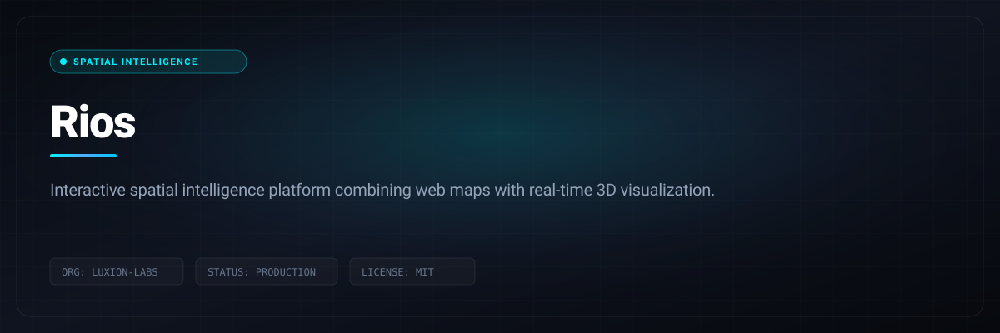

# Rios

> Interactive spatial intelligence platform combining web maps with real-time 3D visualization.

```bash
git clone https://github.com/Luxion-Labs/rios.git && cd rios && npm install && npm run dev
```



[](https://www.rios.luxionlabs.com) [](LICENSE) [](CONTRIBUTING.md)

## Overview
Interactive spatial intelligence platform combining web maps with real-time 3D visualization. Built by Luxion Labs as part of our high-velocity open-source engineering ecosystem.

## Features
- 2D to 3D continuous camera projection transitions.
- Real-world asset telemetry overlaid on geospatial geometry.
- Interactive point-cloud and mesh inspection.
- Hardware-accelerated client-side rendering pipeline.

## Architecture and Stack
TypeScript, Three.js, Leaflet, Vite, WebGL shaders, and high-precision geospatial coordinates.

## Quickstart
```bash
git clone https://github.com/Luxion-Labs/rios.git && cd rios && npm install && npm run dev
```

## Maintainer Response SLA
Luxion Labs enforces a strict 24-hour response SLA on all community issues, feature proposals, and pull requests. See [CONTRIBUTING.md](CONTRIBUTING.md) for full development guidelines.

## License
Distributed under the MIT License. See [LICENSE](LICENSE) for more details.
