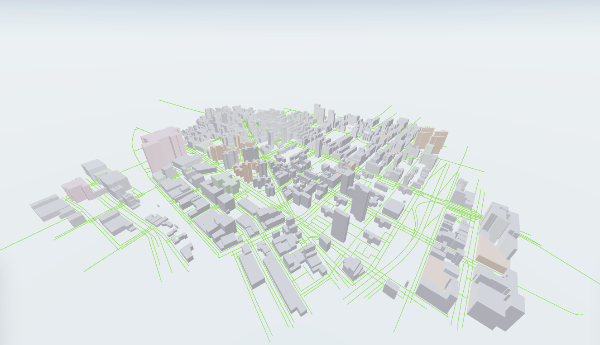

# Rios

Rios is an interactive spatial intelligence platform that combines traditional maps with immersive 3D visualization. It provides a unified workspace to explore, monitor, and interact with real-world assets in context.



<!-- Badges placed immediately below the image -->

[](https://github.com/)
[](https://reactjs.org/)
[](https://www.typescriptlang.org/)
[](https://vitejs.dev/)
[](https://threejs.org/)
[](https://github.com/pmndrs/zustand)
[](https://axios-http.com/)
[](https://leafletjs.com/)
[](https://github.com/)

## Overview

Rios unites geospatial data, mapping, and a synchronized 3D scene into a single interactive interface. Users can search, inspect, and annotate assets while both the map and the 3D visualization remain consistent.

Rios is intended for operations, planning, and analytics teams that need a spatially coherent view of assets and activity. It bridges the gap between traditional GIS workflows and immersive 3D visualization by keeping contextual data synchronized across views.

The platform is optimized for incremental data loading and responsive interactions. Typical workflows include asset inspection, area management, route and vehicle monitoring, and lightweight annotation. Rios is designed to scale from single-site deployments to city-scale datasets by streaming scene geometry and prioritizing visible assets.

**Maintainer note**: I have over 10 years of experience managing open source projects and designed this README to follow established best practices for clarity and contributor onboarding.

## Quick start

Prerequisites

- Node.js 18 or later
- Yarn or npm

Install and run in development

```bash
npm install
npm run dev
```

Build for production

```bash
npm run build
npm run preview
```

## Features

- Interactive 2D map paired with a real-time 3D scene
- Vehicle and asset inspection and monitoring
- Area management and building annotations
- Centralized state for immediate cross-view updates
- Search and navigation tools

## Project structure

Top-level files and directories

- `package.json` - project metadata and scripts
- `src/` - application source code
- `public/` - static assets and images

## How it works

Rios loads backend geospatial and scene data through an API layer. Data is stored in global stores and consumed by both the map UI and the 3D renderer so that interactions update every view instantly.

## Roadmap

Future priorities include real-time IoT integration, live vehicle tracking, multi-user collaboration, AI powered spatial insights, and tools for large-scale digital twin deployments.

## Technical notes and design choices

<details>
<summary>Expand for rationale and badge usage guidance</summary>

Badges are used to communicate important project metadata at a glance. For guidance on badge selection and best practices see the GitHub community discussion: https://github.com/orgs/community/discussions/16925

The project uses `zustand` for compact and efficient global stores. `three` with `@react-three/fiber` provides the 3D scene. `leaflet` and `react-leaflet` provide the map view. Axios is the data layer for HTTP requests.

Performance notes

- Keep 3D scene complexity bounded and load geometry lazily
- Batch state updates to avoid excessive re renders
- Use requestAnimationFrame for smooth scene updates

</details>

## Contributing

Contributions are welcome. Open an issue to propose changes or start a pull request. Follow existing code style and ensure linting remains green by running `npm run lint`.

If you intend to contribute substantial features, open an issue describing the design before implementing the change.

## License

This repository is currently private. Choose a license and update `package.json` to reflect the project license when you make the repository public.

## Contact

For questions or collaboration inquiries open an issue or contact the maintainers through the repository.

<!-- Footer image and duplicated header removed by request -->
